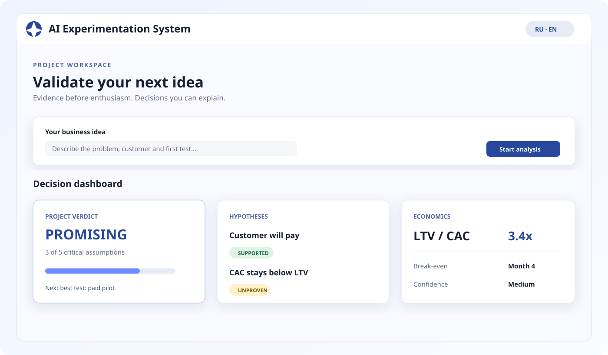
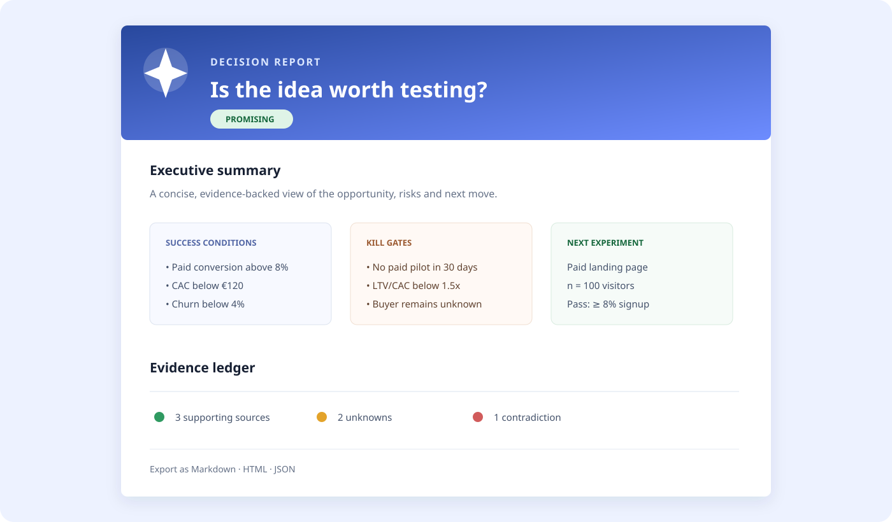

<div align="center">
  
  <h1>AI Experimentation System</h1>
  <p><strong>Проверяйте бизнес-идеи доказательствами, а не энтузиазмом.</strong></p>
  <p>
    <a href="https://github.com/lstkhN/AI-Experimentation-System/actions"></a>
    <a href="LICENSE"></a>
    
  </p>
</div>

---

## Что это?

**AI Experimentation System** — локальная система для принятия решений по бизнес-идеям. Она превращает сырое описание идеи в последовательный процесс:

```text
Идея → Гипотезы → Доказательства → Экономика → Эксперимент → Решение
```

Вместо очередного красивого AI-текста вы получаете видимый reasoning-процесс: что известно, чему можно верить, какие данные противоречат идее и какой тест нужно запустить следующим.

> Проект находится в активной разработке. Это локальный single-user инструмент, а не готовый production SaaS.

## Почему это интересно

| Проблема | Что делает система |
| --- | --- |
| Идея кажется хорошей, но непонятно почему | Разбивает её на проверяемые гипотезы |
| Research превращается в набор ссылок | Ведёт Evidence Ledger с provenance и качеством источников |
| Финансовая модель держится на догадках | Считает unit economics, sensitivity и Monte Carlo-сценарии |
| Команда не знает, что делать дальше | Предлагает следующий эксперимент с pass/fail-правилами |
| Результаты теряются в заметках | Сохраняет audit history и экспортирует decision report |

## Интерфейс

### Рабочее пространство



### Decision report



> Изображения — визуальное превью основных сценариев интерфейса. Рабочая версия запускается локально через Docker Compose.

## Возможности

- intake проекта на русском и английском языках;
- автоматическое формирование и ранжирование гипотез;
- research через подключаемый search provider или локальный fallback;
- Evidence Ledger с источниками, provenance и оценкой качества;
- детерминированные verdict по гипотезам и проекту: `PROMISING`, `WEAK`, `NO-GO-FOR-NOW`, `UNPROVEN`;
- unit economics, sensitivity analysis и Monte Carlo simulation;
- value of information, capital plan и capital gates;
- шаблоны экспериментов и lifecycle `proposed → approved → running → completed`;
- ввод измерений и сравнение фактических результатов с прогнозом;
- audit history и экспорт в JSON, Markdown и HTML;
- Docker Compose для запуска всех сервисов.

Система помогает принимать решения на основе проверяемых данных. Она не заменяет интервью, платные пилоты или реальное рыночное исследование: неподтверждённые search snippets не считаются доказательствами автоматически.

## Архитектура

- **Backend:** Python 3.12, FastAPI, SQLAlchemy, Alembic;
- **База данных:** PostgreSQL в Compose, SQLite для локальных тестов;
- **Worker:** отдельный процесс для очереди analysis runs;
- **Frontend:** Next.js, React, TypeScript;
- **Проверки:** pytest, frontend build и Playwright.

```text
api/app/api/       HTTP endpoints
api/app/db/        модели и сессии SQLAlchemy
api/app/engines/   детерминированная бизнес-логика
api/app/services/  orchestration, research, snapshots и audit
api/app/workers/   worker очереди анализа
api/tests/         backend-тесты
web/app/           Next.js интерфейс
web/tests/         UI/E2E-тесты
```

## Быстрый запуск

Требуется Docker с Docker Compose.

```bash
cp .env.example .env
# При необходимости добавьте ключи в .env:
# OPENAI_API_KEY=...
# SEARCH_API_KEY=...
docker compose up --build
```

После запуска:

- Web: http://127.0.0.1:3000
- API: http://127.0.0.1:8000
- API docs: http://127.0.0.1:8000/docs
- liveness: http://127.0.0.1:8000/health
- readiness: http://127.0.0.1:8000/ready

Миграции применяются отдельным сервисом `migrator`; API не изменяет схему базы при старте.

## Локальная разработка и проверки

```bash
pip install -r api/requirements.txt
cd api
pytest -q
cd ../web
npm ci
npm run build
npm run test:e2e
```

Проверка миграций из корня проекта:

```bash
alembic -c alembic.ini upgrade head
alembic -c alembic.ini current
alembic -c alembic.ini check
```

## Основные API-группы

```text
POST/GET /api/v1/projects
POST/GET /api/v1/projects/{id}/analysis-runs
POST/GET /api/v1/projects/{id}/hypotheses
POST/GET /api/v1/projects/{id}/evidence
POST/GET /api/v1/projects/{id}/verdict
POST     /api/v1/projects/{id}/economics/calculate
POST     /api/v1/projects/{id}/economics/simulate
POST     /api/v1/projects/{id}/economics/value-of-information
POST/GET /api/v1/projects/{id}/experiments/*
GET      /api/v1/projects/{id}/export/{json|markdown|html}
```

Полная интерактивная спецификация доступна в `/docs` после запуска API.

## Конфигурация и безопасность

Секреты задаются только через `.env`, который не должен добавляться в Git. В репозитории находится только `.env.example` с пустыми значениями. Не публикуйте API-ключи, реальные пользовательские данные или локальные базы данных.

Значения PostgreSQL по умолчанию (`analyst`/`analyst`) предназначены только для локального Docker-запуска. Для production-развёртывания их необходимо заменить и добавить authentication, HTTPS, управление доступом и отдельную политику хранения данных.

## Лицензия

Проект распространяется по лицензии MIT. См. [LICENSE](LICENSE).

<div align="center">
  <sub>Built for founders, product teams and evidence-driven experiments.</sub>
</div>
